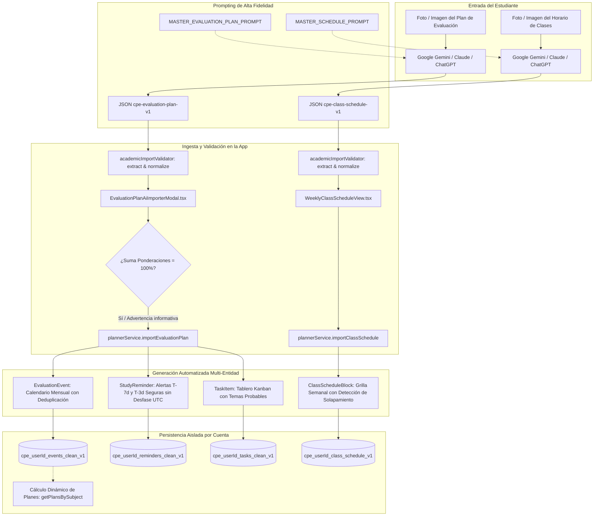

# 📅 CALENDAR, REMINDERS & EVALUATION PLAN SUBSYSTEM SPECIFICATION
## Centro de Productividad Estudiantil (CPE) — Comprehensive Architecture, AI Prompts & Function Audit Map

> **Document Version**: 2.0.0 (Auditoría Forense & Sincronización Total con Código)  
> **Target Audience**: Claude 3.5 / 3.7 / Opus 5.5, Auditores de Código, Estudiantes y QA Leads  
> **Propósito**: Especificar con 100% de fidelidad al código la arquitectura de la Agenda Académica, el motor de ingesta de planes de evaluación y horarios escolares mediante fotografías analizadas con Gemini / IAs multimodales, el sistema de horario escolar semanal con seguimiento en vivo y la generación escalonada de recordatorios y tareas de estudio sin fuga de datos multi-cuenta.  
> **Tech Stack**: React 19, TypeScript 5.8 (Strict Mode), Vite 8.3, Lucide React, LocalStorage Aislado por `userId`, KaTeX, Supabase RLS Ready.  
> **Estado de Compilación**: `tsc -b` (0 errores), `oxlint` (0 errores), `vite build` (0 errores, 100% chunks optimizados).

---

## 📑 ÍNDICE GENERAL DEL SUBSISTEMA
1. [Arquitectura General y Flujo de Ingesta Inteligente](#1-arquitectura-general-y-flujo-de-ingesta-inteligente)
2. [Esquema Canónico JSON: Plan de Evaluación (`cpe-evaluation-plan-v1`)](#2-esquema-canónico-json-plan-de-evaluación-cpe-evaluation-plan-v1)
3. [Prompt Maestro Oficial para Gemini / Claude / ChatGPT (Foto a Plan)](#3-prompt-maestro-oficial-para-gemini--claude--chatgpt-foto-a-plan)
4. [Esquema Canónico JSON: Horario Escolar (`cpe-class-schedule-v1`)](#4-esquema-canónico-json-horario-escolar-cpe-class-schedule-v1)
5. [Prompt Maestro Oficial para Horarios de Clases (Foto a Horario)](#5-prompt-maestro-oficial-para-horarios-de-clases-foto-a-horario)
6. [Motor de Recordatorios Escalonados, Tareas y Deduplicación](#6-motor-de-recordatorios-escalonados-tareas-y-deduplicación)
7. [Seguimiento de Horario en Tiempo Real ("En Clase Ahora" & Ticker Activo)](#7-seguimiento-de-horario-en-tiempo-real-en-clase-ahora--ticker-activo)
8. [Matriz Real de Persistencia Local y Aislamiento Multi-Cuenta (`userId`)](#8-matriz-real-de-persistencia-local-y-aislamiento-multi-cuenta-userid)
9. [Catálogo de Funciones y Trazabilidad Código a Código](#9-catálogo-de-funciones-y-trazabilidad-código-a-código)
10. [Protocolo de Auditoría Rápida para Modelos LLM (Opus 5.5)](#10-protocolo-de-auditoría-rápida-para-modelos-llm-opus-55)

---

## 1. ARQUITECTURA GENERAL Y FLUJO DE INGESTA INTELIGENTE

El subsistema de Agenda Académica resuelve el problema de la fragmentación estudiantil: los profesores entregan cronogramas impresos, fotos borrosas en WhatsApp o archivos PDF con tablas heterogéneas. La aplicación proporciona un puente sin fricción donde la IA multimodal de confianza del alumno (como Google Gemini en móvil o web) extrae los datos y el CPE los transforma en eventos, alertas escalonadas y tareas de estudio.



---

## 2. ESQUEMA CANÓNICO JSON: PLAN DE EVALUACIÓN (`cpe-evaluation-plan-v1`)

Este formato estandarizado garantiza que cualquier modelo de lenguaje devuelva una estructura determinista y tipada en TypeScript. El normalizador acepta alias comunes (`professor` o `teacher`, `academicPeriod` o `term`):

```json
{
  "schemaVersion": "cpe-evaluation-plan-v1",
  "subject": "Física I",
  "professor": "Prof. Carlos Mendoza",
  "academicPeriod": "Semestre 2026-II",
  "totalWeightExpected": 100,
  "evaluations": [
    {
      "title": "Primer Parcial: Cinemática y Dinámica de la Partícula",
      "type": "PARCIAL",
      "date": "2026-11-15",
      "time": "08:00 AM",
      "weightPercentage": 25,
      "location": "Aula 204",
      "topics": [
        "Vectores de posición, velocidad y aceleración en coordenadas cartesianas",
        "Movimiento rectilíneo uniforme y uniformemente variado",
        "Movimiento circular y aceleración centrípeta",
        "Leyes de Newton y diagramas de cuerpo libre",
        "Fricción estática y cinética en planos inclinados"
      ],
      "suggestedStudyAlertDays": [7, 3, 1],
      "notes": "Se permite calculadora científica no programable y hoja de fórmulas autorizada"
    },
    {
      "title": "Segundo Parcial: Trabajo, Energía y Cantidad de Movimiento",
      "type": "PARCIAL",
      "date": "2026-12-10",
      "time": "08:00 AM",
      "weightPercentage": 25,
      "location": "Aula 204",
      "topics": [
        "Teorema del trabajo y la energía cinética",
        "Fuerzas conservativas y energía potencial",
        "Conservación del momento lineal y colisiones en 1D y 2D"
      ],
      "suggestedStudyAlertDays": [7, 3],
      "notes": "Puntualidad estricta. Cierre de puerta a las 08:15 AM"
    },
    {
      "title": "Laboratorio 1 y 2: Mediciones y Ley de Hooke",
      "type": "TALLER",
      "date": "2026-11-22",
      "time": "10:00 AM",
      "weightPercentage": 15,
      "location": "Lab. de Física Básica",
      "topics": [
        "Propagación de incertidumbres y cálculo de errores",
        "Calibración de dinamómetros y constante del resorte"
      ],
      "suggestedStudyAlertDays": [3],
      "notes": "Llevar bata blanca de laboratorio y cuaderno de notas"
    },
    {
      "title": "Proyecto Especial: Simulación de Trayectorias",
      "type": "PROYECTO",
      "date": "2027-01-18",
      "time": "11:59 PM",
      "weightPercentage": 20,
      "location": "Entrega Virtual Classroom",
      "topics": [
        "Modelado computacional de tiro parabólico con resistencia del aire",
        "Informe en formato IEEE con gráficas comparativas"
      ],
      "suggestedStudyAlertDays": [10, 5, 2],
      "notes": "Grupos de máximo 3 integrantes"
    },
    {
      "title": "Tercer Parcial: Dinámica Rotacional y Gravitación",
      "type": "PARCIAL",
      "date": "2027-02-05",
      "time": "08:00 AM",
      "weightPercentage": 15,
      "location": "Aula 204",
      "topics": [
        "Momento de inercia y torque",
        "Conservación del momento angular",
        "Leyes de Kepler y gravitación universal"
      ],
      "suggestedStudyAlertDays": [7, 3],
      "notes": "Evaluación acumulativa final"
    }
  ]
}
```

---

## 3. PROMPT MAESTRO OFICIAL PARA GEMINI / CLAUDE / CHATGPT (FOTO A PLAN)

Este prompt reside dentro de la aplicación en [`EvaluationPlanAiImporterModal.tsx`](file:///c:/Users/user/Desktop/video%20proyectos/A%20new%20proyect/src/components/planner/EvaluationPlanAiImporterModal.tsx) y se genera con año dinámico (`new Date().getFullYear()`):

````text
Actúa como un asistente experto en digitalización académica para el Centro de Productividad Estudiantil (CPE).

Te adjunto una FOTO / IMAGEN / PDF del Plan de Evaluación oficial de mi asignatura.

Tu objetivo es analizar la imagen y estructurar todo el cronograma evaluativo con máxima fidelidad.

INSTRUCCIONES DE EXTRACCIÓN:
1. Extrae el nombre de la Asignatura, Nombre del Profesor y Período Académico (ej. "Semestre 2026-II", "1er Lapso 2026-2027").
2. Identifica cada corte o evaluación (Parcial, Quiz, Taller, Proyecto, Entrega, Recuperación).
3. Determina la fecha exacta en formato ISO (YYYY-MM-DD). Si solo aparece la semana o mes, infiere la fecha más probable del año en curso o ciclo vigente.
4. Extrae la ponderación porcentual exacta (número entre 1 y 100). Verifica que la suma total se acerque o iguale a 100%.
5. Desglosa los TEMAS PROBABLES que evaluará cada prueba según el contenido de la lámina o el orden lógico del programa.
6. Asigna el tipo exacto entre: "PARCIAL", "QUIZ", "ENTREGA", "TALLER", "PROYECTO", "RECUPERACION".

RESPONDE EXCLUSIVAMENTE CON UN BLOQUE JSON VÁLIDO CON LA SIGUIENTE ESTRUCTURA (SIN TEXTO ANTES NI DESPUÉS):

```json
{
  "schemaVersion": "cpe-evaluation-plan-v1",
  "subject": "Nombre de la Asignatura",
  "professor": "Nombre del Docente (o null)",
  "academicPeriod": "Período / Lapso",
  "totalWeightExpected": 100,
  "evaluations": [
    {
      "title": "Primer Parcial: Nombre del Bloque",
      "type": "PARCIAL",
      "date": "2026-11-15",
      "time": "08:00 AM",
      "weightPercentage": 25,
      "location": "Aula 204",
      "topics": [
        "Tema 1 evaluado",
        "Tema 2 evaluado",
        "Tema 3 evaluado"
      ],
      "suggestedStudyAlertDays": [7, 3, 1],
      "notes": "Llevar formulario y calculadora"
    }
  ]
}
```
````

---

## 4. ESQUEMA CANÓNICO JSON: HORARIO ESCOLAR (`cpe-class-schedule-v1`)

Acepta tanto `dayOfWeek` como `day`, y normaliza automáticamente tildes y minúsculas (`MIÉRCOLES` $\to$ `MIERCOLES`, `Sábado` $\to$ `SABADO`):

```json
{
  "schemaVersion": "cpe-class-schedule-v1",
  "institutionName": "Universidad Central de Venezuela (UCV)",
  "studentGradeOrSemester": "1er Semestre — Licenciatura en Física",
  "classes": [
    {
      "subject": "Cálculo I",
      "dayOfWeek": "LUNES",
      "startTime": "07:30",
      "endTime": "09:10",
      "classroom": "Aula 204 - Fac. de Ciencias",
      "professor": "Prof. Martínez",
      "colorTag": "blue",
      "modality": "PRESENCIAL"
    },
    {
      "subject": "Física General I",
      "dayOfWeek": "LUNES",
      "startTime": "09:30",
      "endTime": "11:15",
      "classroom": "Auditorio B",
      "professor": "Dr. Arismendi",
      "colorTag": "indigo",
      "modality": "PRESENCIAL"
    },
    {
      "subject": "Laboratorio de Física I",
      "dayOfWeek": "MIERCOLES",
      "startTime": "08:00",
      "endTime": "12:00",
      "classroom": "Lab. 102 Física Básica",
      "professor": "Dra. Hernández",
      "colorTag": "emerald",
      "modality": "PRESENCIAL"
    },
    {
      "subject": "Geometría Analítica",
      "dayOfWeek": "JUEVES",
      "startTime": "10:00",
      "endTime": "11:45",
      "classroom": "Aula 108",
      "professor": "Prof. Vielma",
      "colorTag": "purple",
      "modality": "PRESENCIAL"
    },
    {
      "subject": "Taller de Programación Científica",
      "dayOfWeek": "VIERNES",
      "startTime": "14:00",
      "endTime": "16:30",
      "classroom": "Sala de Cómputo 3",
      "professor": "Ing. Morales",
      "colorTag": "amber",
      "modality": "HIBRIDO"
    }
  ]
}
```

---

## 5. PROMPT MAESTRO OFICIAL PARA HORARIOS DE CLASES (FOTO A HORARIO)

````text
Actúa como un asistente experto en digitalización escolar y universitaria para el Centro de Productividad Estudiantil (CPE).

Te adjunto una FOTO / CAPTURA DE PANTALLA / PDF de mi Horario Escolar / Académico Semanal.

Tu tarea es:
1. Extraer todas las clases programadas entre LUNES y SÁBADO.
2. Identificar el nombre de la Asignatura, el Día de la semana (LUNES, MARTES, MIERCOLES, JUEVES, VIERNES o SABADO).
3. Extraer la Hora de Inicio y Hora de Fin en formato 24 horas "HH:MM" (ej. "07:30", "09:00", "13:30").
4. Extraer el Aula / Salón / Laboratorio y el Nombre del Docente si aparecen.
5. Asignar la modalidad: "PRESENCIAL", "VIRTUAL" o "HIBRIDO".
6. Asignar un color visual temático ("blue", "indigo", "emerald", "amber", "rose", "purple").

RESPONDE EXCLUSIVAMENTE CON UN BLOQUE JSON VÁLIDO CON ESTA ESTRUCTURA:

```json
{
  "schemaVersion": "cpe-class-schedule-v1",
  "institutionName": "Nombre de la Escuela / Universidad",
  "studentGradeOrSemester": "1er Año / Semestre",
  "classes": [
    {
      "subject": "Matemática",
      "dayOfWeek": "LUNES",
      "startTime": "07:00",
      "endTime": "08:30",
      "classroom": "Salón 3-B",
      "building": "Módulo Central",
      "professor": "Prof. Carlos Ramos",
      "modality": "PRESENCIAL",
      "colorTag": "blue"
    }
  ]
}
```
````

---

## 6. MOTOR DE RECORDATORIOS ESCALONADOS, TAREAS Y DEDUPLICACIÓN

Al presionar **"Confirmar e Inyectar en mi Agenda"**, el motor `plannerService.importEvaluationPlan(userId, payload, options)` ejecuta una triple acción atómica sin duplicaciones:

### 1. Creación del Evento en Calendario (`EvaluationEvent`)
- Verifica si ya existe un evento con el mismo `subject`, `title` y `date`. Si existe, se omite para evitar duplicación.
- Asigna identificador UUID único, tipo, ponderación, temas probables y notas del plan.
- Renderizado de inmediato en la cuadrícula mensual de [`AcademicCalendarView.tsx`](file:///c:/Users/user/Desktop/video%20proyectos/A%20new%20proyect/src/components/planner/AcademicCalendarView.tsx).

### 2. Generación de Recordatorios Escalonados (`StudyReminder`)
- Utiliza la función `calculatePreAlertDate(item.date, days)` que opera con aritmética de calendario local, **eliminando desfases de huso horario UTC**.
- Formato del título generado:  
  `"Alerta (Nd antes): Repasar para [Título] ([Temas probables])"`
- Prioridad calibrada:
  - Si faltan $\le 3$ días: Prioridad **ALTA**.
  - Si faltan $> 3$ días: Prioridad **MEDIA**.
- Deduplicación activa: no inserta recordatorios idénticos si ya existen para la misma materia y fecha de vencimiento.

### 3. Sincronización con el Tablero Kanban (`TaskItem`)
- Si `options.createKanbanTasks` está activo, inyecta la tarea con temas probables incorporados:  
  `"Meta: [Título] ([Ponderación]%) - [Tema 1, Tema 2]"`
- Prioridad ALTA si la ponderación es $\ge 20\%$.
- Deduplicación activa contra tareas existentes en `cpe_${userId}_tasks_clean_v1`.

---

## 7. SEGUIMIENTO DE HORARIO EN TIEMPO REAL ("EN CLASE AHORA" & TICKER ACTIVO)

El componente [`WeeklyClassScheduleView.tsx`](file:///c:/Users/user/Desktop/video%20proyectos/A%20new%20proyect/src/components/planner/WeeklyClassScheduleView.tsx) implementa un motor de monitoreo en tiempo real:

1. **Ticker Activo de 30 Segundos**:
   Mantiene un estado `currentTime` sincronizado con un `setInterval(..., 30000)`, evitando que la interfaz quede congelada si la pestaña permanece abierta.
2. **Detección Dinámica de Clase Actual y Próxima**:
   Compara los minutos acumulados del día ($H \times 60 + M$) contra $[startMin, endMin]$ de cada clase del día actual.
   - En clase: resalta la tarjeta superior en verde esmeralda con indicador animado.
   - Próxima clase: indica el aula, docente y tiempo restante.
3. **Detector de Solapamientos de Horario**:
   La función `checkIsOverlapping(target, allBlocks)` comprueba si $start_1 < end_2 \land start_2 < end_1$ para clases en el mismo día, marcando las tarjetas con la insignia `⚠️ Solapada`.
4. **Modo Reemplazo vs Fusión**:
   Permite al estudiante elegir si desea reemplazar completamente su horario anterior o fusionar nuevas clases sin duplicar las existentes.
5. **Presets por Perfil sin Duplicación**:
   Los botones de 1 clic para Andrés, Santiago y Mafe reemplazan limpiamente el horario para garantizar que no existan clases duplicadas.

---

## 8. MATRIZ REAL DE PERSISTENCIA LOCAL Y AISLAMIENTO MULTI-CUENTA (`userId`)

Todas las claves de almacenamiento local están prefijadas estrictamente bajo `cpe_${userId}_*` para evitar fuga de datos entre perfiles:

| Entidad | Clave LocalStorage Real | Tipo de Datos | Comportamiento en la App |
|---|---|---|---|
| **Evaluaciones / Parciales** | `cpe_${userId}_events_clean_v1` | `EvaluationEvent[]` | Calendario de exámenes exclusivo del perfil activo. |
| **Recordatorios de Examen** | `cpe_${userId}_reminders_clean_v1` | `StudyReminder[]` | Alertas escalonadas deduplicadas (T-7d, T-3d) por cuenta. |
| **Horario Semanal de Clases** | `cpe_${userId}_class_schedule_v1` | `ClassScheduleBlock[]` | Bloques semanales (Lunes a Sábado) con soporte de reemplazo/fusión. |
| **Apuntes y Notas de Estudio** | `cpe_${userId}_notes_clean_v1` | `StudyNote[]` | Cuaderno de apuntes con soporte de fórmulas LaTeX. |
| **Tareas Kanban de Estudio** | `cpe_${userId}_tasks_clean_v1` | `TaskItem[]` | Tickets de estudio en el tablero de productividad. |
| **Planes y Metas por Materia** | *Calculado en Memoria* | `SubjectEvaluationPlan[]` | Calculado dinámicamente mediante `getPlansBySubject(userId)` a partir de eventos reales (Estado Cero, sin redundancia). |

---

## 9. CATÁLOGO DE FUNCIONES Y TRAZABILIDAD CÓDIGO A CÓDIGO

### Métodos de `plannerService.ts`:
| Función | Parámetros | Retorno | Acción / Efecto Secundario |
|---|---|---|---|
| `getClassSchedule` | `userId: string` | `ClassScheduleBlock[]` | Lee del storage el horario semanal. Devuelve `[]` si no existen clases registradas (Estado Cero). |
| `saveClassSchedule` | `userId: string, schedule: ClassScheduleBlock[]` | `void` | Persiste en `cpe_${userId}_class_schedule_v1`. |
| `addClassBlock` | `userId: string, block: Omit<ClassScheduleBlock, 'id'>` | `ClassScheduleBlock` | Genera UUID y agrega un bloque de clase al horario semanal. |
| `updateClassBlock` | `userId: string, id: string, patch: Partial<ClassScheduleBlock>` | `void` | Actualiza asignatura, hora, aula o docente de una clase específica. |
| `deleteClassBlock` | `userId: string, id: string` | `void` | Elimina un bloque de clase del horario. |
| `importClassSchedule` | `userId: string, payload: ClassScheduleImportPayload, replaceExisting: boolean = false` | `number` | Ingesta en lote con soporte de reemplazo total o fusión inteligente sin duplicados. |
| `importEvaluationPlan` | `userId: string, payload: EvaluationPlanImportPayload, options: { createReminders?, createKanbanTasks?, userAcademicProfile? }` | `{ eventsCreated, remindersCreated, tasksCreated }` | **Motor de digitalización**: inyecta eventos, alertas escalonadas T-7d y T-3d con fecha local segura, y tickets Kanban con temas probables. |

### Utilidades de `academicImportValidator.ts`:
| Función | Parámetros | Retorno | Acción |
|---|---|---|---|
| `extractJsonFromAiResponse` | `rawText: string` | `string` | Extrae el bloque JSON seguro eliminando markdown o textos explicativos antes o después. |
| `normalizeDayOfWeek` | `dayInput: string` | `DayOfWeek \| null` | Normaliza tildes y mayúsculas (`MIÉRCOLES` $\to$ `MIERCOLES`, `Sábado` $\to$ `SABADO`). |
| `validateAndNormalizeEvaluationPlan` | `rawJson: any` | `ValidationResult<EvaluationPlanImportPayload>` | Valida campos obligatorios, normaliza alias de docente/período y verifica ponderaciones. |
| `validateAndNormalizeClassSchedule` | `rawJson: any` | `ValidationResult<ClassScheduleImportPayload>` | Valida clases, normaliza horas HH:MM y alias `day`/`dayOfWeek`. |
| `calculatePreAlertDate` | `baseDateStr: string, daysPrior: number` | `string` | Aritmética pura de calendario local sin conversión UTC para evitar desfase de días. |

---

## 10. PROTOCOLO DE AUDITORÍA RÁPIDA PARA MODELOS LLM (OPUS 5.5)

Para auditar este subsistema en menos de 15 segundos sin exploraciones redundantes:

1. **Aislamiento Multi-Cuenta**:
   - Comprobar que todas las claves en `plannerService.ts` lleven el prefijo `cpe_${userId}_`.
   - Comprobar que no existan variables globales ni llamadas a `localStorage` sin `userId`.
2. **Detección en Vivo y Purity**:
   - Constatar que `liveStatus` en [`WeeklyClassScheduleView.tsx`](file:///c:/Users/user/Desktop/video%20proyectos/A%20new%20proyect/src/components/planner/WeeklyClassScheduleView.tsx) dependa de `currentTime` manejado por un `useEffect` con `setInterval(..., 30000)`.
3. **Robustez ante Errores de Formato de IA**:
   - Verificar que `extractJsonFromAiResponse` procese respuestas con texto introductorio ("Aquí tienes tu JSON:").
   - Verificar que `normalizeDayOfWeek` acepte días con o sin tilde en mayúsculas o minúsculas.
4. **Calidad de Compilación**:
   - `npx tsc -b`: debe reportar **0 errores**.
   - `npx oxlint`: debe reportar **0 errores**.
   - `npx vite build`: debe compilar el bundle de producción limpiamente.
